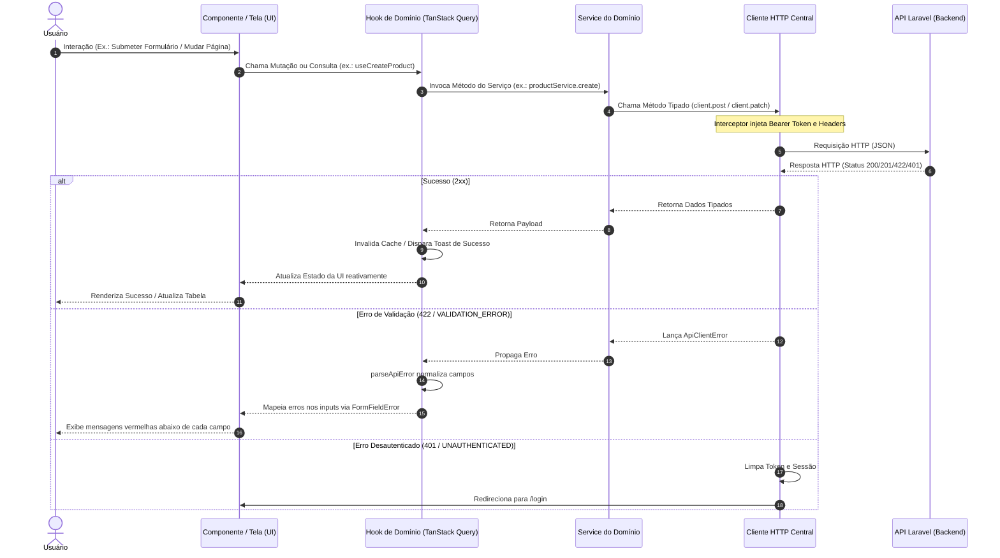

# Arquitetura do Apollo System Frontend

Este documento descreve detalhadamente a arquitetura, convenções, padrões de projeto e fluxos operacionais do frontend do **Apollo System**, construído em Next.js (App Router), React 19, TypeScript e Tailwind CSS.

---

## 1. Estrutura de Pastas e Convenções de Nomenclatura

A arquitetura adota o padrão **Feature-Driven (Modular por Domínio)**. Cada domínio de negócio possui seu próprio diretório contendo componentes, hooks, services, schemas e types. Componentes genéricos e infraestrutura técnica residem em diretórios globais agnósticos.

### 1.1. Árvore do Projeto

```text
apollo-react-next/
├── app/                                    # Next.js App Router (Páginas e Roteamento)
│   ├── (auth)/                             # Grupo de rotas públicas / de autenticação
│   │   ├── login/page.tsx                  # Tela de autenticação multi-tenant
│   │   └── register-organization/page.tsx  # Tela de cadastro da organização
│   ├── (dashboard)/                        # Grupo de rotas protegidas por autenticação
│   │   ├── layout.tsx                      # App Shell (Sidebar, Header, proteção de sessão)
│   │   ├── page.tsx                        # Visão geral / Dashboard inicial
│   │   ├── products/                       # Rotas de Catálogo de Produtos
│   │   ├── brands/                         # Rotas de Marcas
│   │   ├── categories/                     # Rotas de Categorias
│   │   ├── clients/                        # Rotas de Clientes e Endereços
│   │   ├── sellers/                        # Rotas de Vendedores e Endereços
│   │   ├── suppliers/                      # Rotas de Fornecedores e Endereços
│   │   ├── sales-orders/                   # Rotas de Pedidos de Venda
│   │   ├── purchase-orders/                # Rotas de Pedidos de Compra
│   │   └── users/                          # Rotas de Usuários e Permissões
│   ├── layout.tsx                          # Root Layout (Providers de Tema, Cache e Toaster)
│   ├── globals.css                         # Estilos globais e tokens CSS
│   └── not-found.tsx                       # Página 404 personalizada
│
├── components/                             # Componentes de interface agnósticos de domínio
│   ├── ui/                                 # Componentes primitivos shadcn/ui (Button, Card, Table, Dialog, etc.)
│   ├── layout/                             # Componentes estruturais (Sidebar, Header, UserNav)
│   ├── providers/                          # Provedores de contexto (QueryProvider, ThemeProvider)
│   └── common/                             # Componentes visuais utilitários compartilhados
│       ├── page-header.tsx                 # Cabeçalho padrão de página com título e botões
│       ├── data-table-pagination.tsx       # Paginação padronizada compatível com a API Laravel
│       ├── empty-state.tsx                 # Estado vazio amigável com ícone e ação
│       ├── loading-skeleton.tsx            # Skeletons para tabelas e formulários
│       ├── confirm-dialog.tsx              # Modal de confirmação para ações críticas
│       ├── form-field-error.tsx            # Exibidor único de mensagens de validação
│       └── money-display.tsx               # Renderizador tipado para strings monetárias (BRL)
│
├── features/                               # Módulos organizados estritamente por domínio de negócio
│   ├── auth/                               # Domínio: Autenticação e Organização
│   ├── products/                           # Domínio: Produtos e Estoque
│   ├── brands/                             # Domínio: Marcas
│   ├── categories/                         # Domínio: Categorias
│   ├── clients/                            # Domínio: Clientes e Endereços
│   ├── sellers/                            # Domínio: Vendedores
│   ├── suppliers/                          # Domínio: Fornecedores
│   ├── sales-orders/                       # Domínio: Pedidos de Venda
│   ├── purchase-orders/                    # Domínio: Pedidos de Compra
│   ├── addresses/                          # Domínio: Gestão de Endereços
│   └── users/                              # Domínio: Usuários e Permissões
│       # Dentro de cada feature/:
│       ├── components/                     # Componentes visuais específicos da feature
│       ├── hooks/                          # Hooks de dados (useQuery/useMutation) e formulários
│       ├── services/                       # Funções de chamada à API usando o cliente HTTP
│       ├── schemas/                        # Schemas Zod de validação
│       └── types/                          # Interfaces e tipos TypeScript do domínio
│
├── lib/                                    # Infraestrutura técnica e utilitários agnósticos
│   ├── api/
│   │   ├── client.ts                       # Cliente HTTP tipado com interceptors
│   │   ├── errors.ts                       # parseApiError e applyApiValidationErrors
│   │   └── types.ts                        # Envelopes de resposta (ApiResponse, PaginatedResponse)
│   ├── auth/
│   │   ├── token.ts                        # Leitura e escrita do token Bearer (localStorage e cookies)
│   │   └── session.ts                      # Sessão do usuário logado
│   ├── diff.ts                             # Cálculo determinístico de diff para requisições PATCH
│   ├── formatters.ts                       # Formatadores nativos Intl (Moeda BRL, Datas pt-BR)
│   ├── masks.ts                            # Máscaras puras em TypeScript (CNPJ, CPF, CEP, Telefone, NCM)
│   └── utils.ts                            # Função `cn` para classes CSS
│
├── docs/                                   # Documentação técnica do projeto
│   ├── ARCHITECTURE.md                     # Este documento
│   └── DEPENDENCIES.md                     # Justificativa de todas as dependências
└── README.md                               # Guia de instalação, execução e visão geral
```

### 1.2. Convenções de Nomes

* **Arquivos e Pastas**: `kebab-case` (ex.: `sales-orders`, `form-field-error.tsx`, `use-products.ts`).
* **Componentes React**: `PascalCase` (ex.: `DataTablePagination`, `ProductForm`).
* **Funções e Utilitários**: `camelCase` (ex.: `formatBRL`, `parseApiError`, `calculateDiff`).
* **Tipos e Interfaces**: `PascalCase` (ex.: `ProductResource`, `ParsedApiError`).
* **Constantes e Schemas**: `camelCase` terminando com `Schema` (ex.: `productSchema`, `loginSchema`).

---

## 2. Fluxo de Dados Unidirecional

Nenhum componente de tela realiza chamadas `fetch` ou `axios` diretamente. Os componentes apenas apresentam dados e despacham eventos. Toda a lógica de requisição, cache e mutação é orquestrada por **Hooks**, que utilizam **Services**, que por sua vez utilizam o **Cliente HTTP central**.

### Diagrama de Fluxo de Dados (Mermaid)



---

## 3. Fluxo de Autenticação e Segurança

A autenticação é multi-tenant e baseada em token Bearer:

1. **Login (`POST /v1/login`)**:
   * O usuário envia `email`, `password` e `organization_document` (CNPJ ou CPF limpo de pontuação).
   * A API responde com `{ data: { token: string, user: User } }`.
2. **Armazenamento de Credenciais**:
   * O token é armazenado no `localStorage` e também sincronizado em cookie `apollo_auth_token` com política `SameSite=Lax`.
   * Os dados básicos do usuário autenticado são armazenados em `localStorage` para exibição na UI.
3. **Injeção de Token Automática**:
   * O cliente HTTP central ([`lib/api/client.ts`](file:///home/jhimy-ferrari/repos/apollo/apollo-react-next/lib/api/client.ts)) intercepta **todas** as requisições e injeta automaticamente o cabeçalho:
     ```http
     Authorization: Bearer <token>
     ```
4. **Proteção de Rotas**:
   * O layout do dashboard ([`app/(dashboard)/layout.tsx`](file:///home/jhimy-ferrari/repos/apollo/apollo-react-next/app/(dashboard)/layout.tsx)) valida se o token existe no cliente. Caso inexistente, o usuário é redirecionado instantaneamente para `/login`.
5. **Expiração e Desautenticação (HTTP 401)**:
   * Sempre que qualquer requisição retornar status `401` ou código `UNAUTHENTICATED`, o interceptor do cliente HTTP limpa imediatamente a sessão local (`removeToken()`, `clearSession()`) e redireciona determinísticamente para `/login`.
6. **Logout Determinístico (`POST /v1/logout`)**:
   * O cliente dispara uma requisição `POST /v1/logout` para o backend Laravel e, em seguida (mesmo em caso de falha de rede), remove todas as credenciais do navegador e redireciona para `/login`.

---

## 4. Fluxo e Normalização de Tratamento de Erros

O tratamento de erros foi desenhado para ser resiliente e unificado através do utilitário central [`parseApiError`](file:///home/jhimy-ferrari/repos/apollo/apollo-react-next/lib/api/errors.ts).

### 4.1. Resolução da Divergência de Contratos (Explicação Técnica do Item 1.7)

No ecossistema Laravel tradicional, exceções de validação (`ValidationException`) retornam por padrão:
```json
{
  "message": "The given data was invalid.",
  "errors": {
    "email": ["O campo e-mail é obrigatório."],
    "items.0.quantity": ["A quantidade do item 1 deve ser maior que zero."]
  }
}
```

Por outro lado, o contrato específico do sistema ERP Apollo estabelece que os erros da API vêm encapsulados na chave `error`:
```json
{
  "error": {
    "code": "VALIDATION_ERROR",
    "message": "Dados inválidos.",
    "fields": {
      "email": ["O campo e-mail é obrigatório."],
      "items.0.quantity": ["A quantidade do item 1 deve ser maior que zero."]
    }
  }
}
```

**Como o Apollo System resolve isso:**
O utilitário [`parseApiError`](file:///home/jhimy-ferrari/repos/apollo/apollo-react-next/lib/api/errors.ts) normaliza **ambos** os formatos para uma interface única e previsível:

```typescript
export interface ParsedApiError {
  code: string;                  // ex: "VALIDATION_ERROR", "UNAUTHENTICATED", "NOT_FOUND"
  message: string;               // Mensagem amigável em português
  fields: Record<string, string[]>; // Dicionário de campos com suas mensagens
  statusCode: number;            // Código HTTP (422, 401, 404, 500, etc.)
  isValidationError: boolean;    // true se for 422 ou VALIDATION_ERROR
  isUnauthenticated: boolean;    // true se for 401 ou UNAUTHENTICATED
}
```

### 4.2. Comportamento na Interface de Usuário

1. **`isValidationError === true`**:
   * O helper `applyApiValidationErrors(parsed, setError)` mapeia cada chave de `fields` diretamente para o `react-hook-form`.
   * Chaves aninhadas (ex.: `items.0.quantity` ou `categories.0.id`) são atribuídas ao caminho exato do formulário.
   * O componente [`FormFieldError`](file:///home/jhimy-ferrari/repos/apollo/apollo-react-next/components/common/form-field-error.tsx) exibe a mensagem em vermelho logo abaixo do input correspondente.
2. **`isUnauthenticated === true`**:
   * Limpeza de sessão e redirecionamento imediato para a tela de login.
3. **Demais Erros (403, 404, 500 ou Genéricos)**:
   * A mensagem `parsed.message` é exibida em toast flutuante (`toast.error()`). Se o servidor não enviar mensagem, o sistema utiliza o texto padrão: `"Ocorreu um erro inesperado. Por favor, tente novamente."`.

---

## 5. Como Adicionar uma Nova Feature Seguindo o Padrão (Passo a Passo)

Para criar um novo módulo no ERP (ex.: `brands`, `categories`, `clients`):

### Passo 1: Criar os Tipos (`features/[nome]/types/index.ts`)
Defina as interfaces baseadas estritamente no OpenAPI (`api.json`):
```typescript
export interface BrandResource {
  id: string;
  number: number;
  name: string;
  description: string | null;
  created_at: string | null;
  updated_at: string | null;
}
```

### Passo 2: Criar o Schema de Validação (`features/[nome]/schemas/[nome].schema.ts`)
Validação com Zod para o formulário no cliente:
```typescript
import { z } from "zod";

export const brandSchema = z.object({
  name: z.string().min(1, "Nome é obrigatório"),
  description: z.string().optional(),
});
export type BrandFormData = z.infer<typeof brandSchema>;
```

### Passo 3: Criar o Service (`features/[nome]/services/[nome].service.ts`)
Utilize o `apiClient` tipado:
```typescript
import { apiClient } from "@/lib/api/client";
import type { PaginatedResponse } from "@/lib/api/types";
import type { BrandResource, BrandFormData } from "../types";

export const brandService = {
  list(params?: { page?: number }) {
    return apiClient.get<PaginatedResponse<BrandResource>>("/v1/brands", params);
  },
  getById(id: string) {
    return apiClient.get<{ data: BrandResource }>(`/v1/brands/${id}`);
  },
  create(data: BrandFormData) {
    return apiClient.post<{ message: string; data: BrandResource }>("/v1/brands", data);
  },
  update(id: string, data: Partial<BrandFormData>) {
    return apiClient.patch<void>(`/v1/brands/${id}`, data);
  },
  delete(id: string) {
    return apiClient.delete<void>(`/v1/brands/${id}`);
  },
};
```

### Passo 4: Criar os Hooks com TanStack Query (`features/[nome]/hooks/use-[nome].ts`)
Encapsule chamadas, mutações, toasts e invalidação de cache:
```typescript
import { useQuery, useMutation, useQueryClient } from "@tanstack/react-query";
import { toast } from "sonner";
import { brandService } from "../services/brand.service";

export function useBrands(page = 1) {
  return useQuery({
    queryKey: ["brands", page],
    queryFn: () => brandService.list({ page }),
  });
}
```

### Passo 5: Criar os Componentes (`features/[nome]/components/`)
* Crie a tabela de listagem utilizando `Table`, `Badge`, `DropdownMenu` e `DataTablePagination`.
* Crie o formulário utilizando `react-hook-form`, `zodResolver`, `FormFieldError` e calcule diffs com `calculateDiff(original, atual)` em edições PATCH.

### Passo 6: Conectar à Rota do App Router (`app/(dashboard)/[nome]/page.tsx`)
Apresente a página com `PageHeader`, `TableSkeleton`, `EmptyState` e a tabela do domínio.

---

## 6. Controle de Acesso e Matriz de Permissões (RBAC)

O controle de acesso no Apollo System é estruturado em torno da ideia de **4 tipos fundamentais de permissões** padronizadas para cada domínio de negócio:

| Ação | Ação Canônica | Operação HTTP correspondente | Descrição |
| :--- | :--- | :--- | :--- |
| **Ler (Read)** | `read` (`*.view`) | `GET /v1/[recurso]` | Consulta de listagens, detalhes e visualização |
| **Criar (Create)** | `create` (`*.create`) | `POST /v1/[recurso]` | Cadastro e persistência de novos registros |
| **Editar (Update)** | `update` (`*.update`) | `PATCH /v1/[recurso]/{id}` | Edição de campos e modificação cadastral |
| **Deletar (Delete)** | `delete` (`*.delete`) | `DELETE /v1/[recurso]/{id}` | Exclusão ou cancelamento de registros |

### 6.1. Domínios do Sistema

As permissões são estritamente agrupadas por seus 9 domínios operacionais:

1. **`users` (Usuários)**: `user.view`, `user.create`, `user.update`, `user.delete`
2. **`products` (Produtos)**: `product.view`, `product.create`, `product.update`, `product.delete`
3. **`brands` (Marcas)**: `brand.view`, `brand.create`, `brand.update`, `brand.delete`
4. **`categories` (Categorias)**: `category.view`, `category.create`, `category.update`, `category.delete`
5. **`clients` (Clientes)**: `client.view`, `client.create`, `client.update`, `client.delete`
6. **`sellers` (Vendedores)**: `seller.view`, `seller.create`, `seller.update`, `seller.delete`
7. **`suppliers` (Fornecedores)**: `supplier.view`, `supplier.create`, `supplier.update`, `supplier.delete`
8. **`sales-orders` (Pedidos de Venda)**: `sales-order.view`, `sales-order.create`, `sales-order.update`, `sales-order.delete`
9. **`purchase-orders` (Pedidos de Compra)**: `purchase-order.view`, `purchase-order.create`, `purchase-order.update`, `purchase-order.delete`

Totalizando 36 permissões atômicas.

### 6.2. Interface da Matriz de Permissões

Na tela de gerenciamento de usuários (`/users/new` e `/users/[id]`):
* Os módulos são apresentados visualmente em cards individuais com identificação de domínio (ex: `users.*`, `sellers.*`).
* Cada card contém 4 controles independentes colorizados por ação (Azul para Leitura, Verde para Criação, Amarelo para Edição, Vermelho para Exclusão).
* Botões de conveniência em lote permitem:
  * **Selecionar Todas**: Concede acesso total irrestrito (36 permissões).
  * **Somente Leitura (Read)**: Concede acesso de consulta em todos os 9 módulos (9 permissões de leitura), ideal para auditores e visualizadores.
  * **Marcar / Desmarcar Módulo**: Atribuição instantânea das 4 ações daquele domínio.

---

## 7. Regras de Negócio de Produtos, Estoque e Máscaras Numéricas

### 7.1. Imutabilidade de Estoque em Edições de Produto

No Apollo System, o estoque de um produto reflete movimentações físicas rastreáveis (`StockMovement`). Por isso:
* **Cadastro Inicial (`POST /products`)**: O operador pode opcionalmente definir uma quantidade inicial (`stock_quantity`).
* **Edição de Produto (`PATCH /products/{id}`)**: O campo de estoque é **completamente ocultado** da interface e **omitido do payload**. Nenhuma requisição de update envia `stock_quantity`.
* **Movimentações Posteriores**: Qualquer ajuste no saldo de estoque deve ser efetuado exclusivamente através da emissão e confirmação de **Pedidos de Compra** (entrada) ou **Pedidos de Venda** (saída).

### 7.2. Máscaras Numéricas e Decimais com Vírgula

Para garantir uma digitação intuitiva e sem erros no padrão brasileiro:
* **Separador Decimal**: Ao digitar a vírgula (`,`) ou ponto no teclado numérico, o cursor transiciona imediatamente para a parte decimal.
* **Preços de Custo e Venda (`cost_price`, `sale_price`)**:
  * Apenas números (0-9) e no máximo uma única vírgula.
  * Suporta até **4 casas decimais** (`maskPrice(val)`), compatível com a escala de armazenamento do backend (`decimal:4`).
* **Quantidade de Estoque (`stock_quantity`)**:
  * Apenas números (0-9) e no máximo uma única vírgula.
  * Suporta até **3 casas decimais** (`maskStock(val)`), permitindo fracionamentos em quilos, metros ou litros (ex.: `2,500`).
* **Sanitização para a API**: Ao submeter o formulário, as vírgulas são convertidas para ponto (`Number(val.replace(",", "."))`) gerando números JSON válidos sem perda de precisão.

