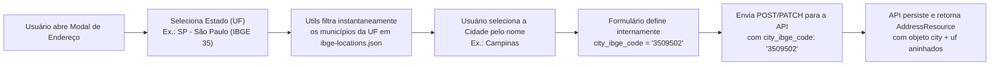

# Guia Detalhado de Funcionalidades, Módulos e Fluxos de Trabalho

Este documento detalha o funcionamento operacional e técnico de **todos os módulos** do frontend do **Apollo System**, incluindo rotas, permissões exigidas (RBAC), contratos de endpoints consumidos, validações de formulário, máscaras e regras de negócio específicas.

---

## Sumário

1. [Visão Geral dos Módulos e Rotas](#1-visão-geral-dos-módulos-e-rotas)
2. [Autenticação e Onboarding Multi-Tenant (`auth`)](#2-autenticação-e-onboarding-multi-tenant-auth)
3. [Dashboard Executivo (`/`)](#3-dashboard-executivo-)
4. [Gestão de Usuários e Permissões (`users`)](#4-gestão-de-usuários-e-permissões-users)
5. [Catálogo: Marcas (`brands`) e Categorias (`categories`)](#5-catálogo-marcas-brands-e-categorias-categories)
6. [Catálogo: Produtos e Estoque (`products`)](#6-catálogo-produtos-e-estoque-products)
7. [Parceiros Comerciais: Clientes (`clients`), Vendedores (`sellers`) e Fornecedores (`suppliers`)](#7-parceiros-comerciais-clientes-clients-vendedores-sellers-e-fornecedores-suppliers)
8. [Gestão de Endereços Polimórficos e Seleção UF $\rightarrow$ Cidade IBGE (`addresses`)](#8-gestão-de-endereços-polimórficos-e-seleção-uf--cidade-ibge-addresses)
9. [Pedidos de Venda (`sales-orders`) e Pedidos de Compra (`purchase-orders`)](#9-pedidos-de-venda-sales-orders-e-pedidos-de-compra-purchase-orders)
10. [Endpoints de Lookup para Seletores (`lookups`)](#10-endpoints-de-lookup-para-seletores-lookups)
11. [Relatórios Gerenciais (`reports`)](#11-relatórios-gerenciais-reports)
12. [Tabela de Referência Rápida: Máscaras e Formatadores](#12-tabela-de-referência-rápida-máscaras-e-formatadores)

---

## 1. Visão Geral dos Módulos e Rotas

| Módulo | Rota Base | Permissão de Leitura | Permissão de Criação | Permissão de Edição | Permissão de Exclusão |
| :--- | :--- | :--- | :--- | :--- | :--- |
| **Dashboard** | `/` | Livre (Autenticado) | — | — | — |
| **Produtos** | `/products` | `product.view` | `product.create` | `product.update` | `product.delete` |
| **Marcas** | `/brands` | `brand.view` | `brand.create` | `brand.update` | `brand.delete` |
| **Categorias** | `/categories` | `category.view` | `category.create` | `category.update` | `category.delete` |
| **Clientes** | `/clients` | `client.view` | `client.create` | `client.update` | `client.delete` |
| **Vendedores** | `/sellers` | `seller.view` | `seller.create` | `seller.update` | `seller.delete` |
| **Fornecedores** | `/suppliers` | `supplier.view` | `supplier.create` | `supplier.update` | `supplier.delete` |
| **Pedidos de Venda** | `/sales-orders` | `sales-order.view` | `sales-order.create` | `sales-order.update` | `sales-order.delete` |
| **Pedidos de Compra** | `/purchase-orders` | `purchase-order.view` | `purchase-order.create` | `purchase-order.update` | `purchase-order.delete` |
| **Usuários** | `/users` | `user.view` | `user.create` | `user.update` | `user.delete` |
| **Relatórios** | `/reports` | `sales-order.view` / `purchase-order.view` | — | — | — |

---

## 2. Autenticação e Onboarding Multi-Tenant (`auth`)

Localização: [`features/auth/`](file:///home/jhimy-ferrari/repos/apollo/apollo-react-next/features/auth)

### 2.1. Login (`/login`)
* **Componente**: [`LoginForm`](file:///home/jhimy-ferrari/repos/apollo/apollo-react-next/features/auth/components/login-form.tsx)
* **Endpoint**: `POST /api/v1/login` (BFF) $\rightarrow$ `POST /v1/login` (Laravel)
* **Campos e Regras**:
  * `organization_document`: CPF (11 dígitos) ou CNPJ (14 caracteres numéricos ou alfanuméricos). Aplicada máscara dinâmica via `maskDocument()` durante a digitação e enviado limpo via `cleanDocument()`.
  * `email`: E-mail válido do operador.
  * `password`: Senha de acesso.
* **Comportamento Pós-Login**:
  * O BFF armazena o token Sanctum em cookie `HttpOnly` cifrado (AES-256-GCM), sem expô-lo ao `localStorage` ou ao JavaScript, e retorna apenas o objeto `user` sanitizado.
  * O [`AuthProvider`](file:///home/jhimy-ferrari/repos/apollo/apollo-react-next/components/providers/auth-provider.tsx) hidrata a sessão e permissões em memória (revalidada no servidor via `GET /v1/me`) antes de redirecionar para `/`.

### 2.2. Cadastro de Organização (`/register-organization`)
* **Componente**: [`RegisterOrgForm`](file:///home/jhimy-ferrari/repos/apollo/apollo-react-next/features/auth/components/register-org-form.tsx)
* **Endpoint**: `POST /v1/organizations`
* **Campos e Regras**:
  * **Dados da Organização**:
    * `person_type`: `"individual"` (Pessoa Física) ou `"company"` (Pessoa Jurídica).
    * `name`: Nome ou Razão Social (até 90 caracteres).
    * `trade_name`: Nome Fantasia (habilitado apenas quando `person_type === "company"`, até 90 caracteres).
    * `document_number`: CPF ou CNPJ formatado dinamicamente de acordo com `person_type`.
    * `email` e `phone`: Contato principal da empresa.
  * **Dados do Administrador Inicial (`user`)**:
    * `user.name`, `user.email`, `user.password` e `user.password_confirmation` (mínimo de 8 caracteres, exigindo letras maiúsculas, minúsculas, números e símbolos).

---

## 3. Dashboard Executivo (`/`)

Localização: [`app/(dashboard)/page.tsx`](file:///home/jhimy-ferrari/repos/apollo/apollo-react-next/app/(dashboard)/page.tsx)

* **Objetivo**: Apresentar um panorama operacional imediato da organização, respeitando as permissões individuais do usuário logado.
* **Funcionamento**:
  * Consulta de forma condicional (apenas se o usuário tiver a respectiva permissão `*.view`) os contadores paginados (`meta.total`) e os registros mais recentes de **Produtos**, **Clientes**, **Pedidos de Venda** e **Pedidos de Compra**.
  * Exibe atalhos rápidos para emissão de novo Pedido de Venda, novo Pedido de Compra, cadastro de Produto e cadastro de Cliente (protegidos por `<Can>`).

---

## 4. Gestão de Usuários e Permissões (`users`)

Localização: [`features/users/`](file:///home/jhimy-ferrari/repos/apollo/apollo-react-next/features/users)

* **Rotas**:
  * `/users`: Listagem paginada com busca por nome/e-mail e badges indicando **Administrador** ou quantidade de permissões atribuídas.
  * `/users/new`: Criação de novo operador e atribuição visual de permissões.
  * `/users/[id]`: Edição de dados cadastrais, redefinição opcional de senha e atualização da matriz de permissões.
* **Endpoints**:
  * `GET /v1/me`, `GET /v1/users`, `GET /v1/users/{id}`, `POST /v1/users`, `PATCH /v1/users/{id}`, `DELETE /v1/users/{id}`, `PATCH /v1/users/me/password`.
* **Matriz Interativa de Permissões ([`UserForm`](file:///home/jhimy-ferrari/repos/apollo/apollo-react-next/features/users/components/user-form.tsx))**:
  * Organiza as **32 permissões operacionais** atribuíveis em **8 cards de domínio** (`product`, `brand`, `category`, `client`, `seller`, `supplier`, `sales-order`, `purchase-order`). As 4 permissões de `user.*` são reservadas exclusivamente a administradores (`is_administrator` ou usuários com permissões `user.*`), cujas permissões não são editáveis pela matriz.
  * Oferece botões de ação rápida:
    * **Selecionar Todas** (32 permissões operacionais)
    * **Apenas Leitura** (as 8 permissões `*.view` dos domínios operacionais)
    * **Limpar Todas**
    * **Alternar Domínio Individual** (marca/desmarca as 4 permissões de um card específico).
* **Regras de Edição de Terceiros (`PATCH /v1/users/{id}`)**:
  * Utiliza `calculateDiff` para enviar apenas os campos modificados (`name`, `email`, `permissions` para não-administradores e `password` opcional).
  * **Redefinição de senha de terceiros**: A senha na edição é opcional e segue as regras de senha forte (mínimo 8 caracteres, com maiúscula, minúscula, número e símbolo). Se deixada em branco, é omitida do payload para manter a senha atual; quando informada, o backend revoga todos os tokens ativos do usuário alvo.
  * **Proteção contra Autoedição**: O backend bloqueia autoedição em `PATCH /v1/users/{id}` (`403`). Na listagem (`UserTable`), o usuário logado exibe a badge `"Você"`, substitui a ação `"Editar Usuário"` por `"Alterar Minha Senha"` e oculta `"Excluir"`; no formulário (`UserForm`), os campos ficam desabilitados quando o alvo é o próprio usuário e é exibido o botão `"Alterar Minha Senha"`.
* **Alteração da Própria Senha (`PATCH /v1/users/me/password`)**:
  * Implementada pelo modal [`ChangeOwnPasswordDialog`](file:///home/jhimy-ferrari/repos/apollo/apollo-react-next/features/users/components/change-own-password-dialog.tsx), acessível pelo menu do usuário (`UserNav`), pela tabela (`UserTable`) e pelo formulário (`UserForm`).
  * Disponível para **qualquer usuário autenticado** (não exige `user.update`), solicita `current_password`, `password` (diferente da atual e dentro das regras de senha forte) e `password_confirmation` (validada no cliente), enviando `{ current_password, password }` para a API. O token da sessão atual permanece ativo enquanto os demais dispositivos são revogados.

---

## 5. Catálogo: Marcas (`brands`) e Categorias (`categories`)

Localizações: [`features/brands/`](file:///home/jhimy-ferrari/repos/apollo/apollo-react-next/features/brands) e [`features/categories/`](file:///home/jhimy-ferrari/repos/apollo/apollo-react-next/features/categories)

* **Rotas**:
  * Marcas: `/brands`, `/brands/new`, `/brands/[id]`
  * Categorias: `/categories`, `/categories/new`, `/categories/[id]`
* **Endpoints**:
  * `GET /v1/brands`, `GET /v1/brands/{id}`, `POST /v1/brands`, `PATCH /v1/brands/{id}`, `DELETE /v1/brands/{id}`
  * `GET /v1/categories`, `GET /v1/categories/{id}`, `POST /v1/categories`, `PATCH /v1/categories/{id}`, `DELETE /v1/categories/{id}`
* **Campos**:
  * `name` (obrigatório, máx. 45 caracteres).
  * `description` (opcional, máx. 225 caracteres).
* **Funcionalidades**:
  * Criação e edição rápida tanto por página dedicada quanto por modal, com cálculo de diff no `PATCH` e exclusão protegida por diálogo de confirmação (`ConfirmDialog`).

---

## 6. Catálogo: Produtos e Estoque (`products`)

Localização: [`features/products/`](file:///home/jhimy-ferrari/repos/apollo/apollo-react-next/features/products)

* **Rotas**:
  * `/products`: Listagem paginada com filtros combinados (busca textual, código interno, NCM, marca, faixa de preço de venda, estoque zerado).
  * `/products/new`: Formulário completo de cadastro de produto.
  * `/products/[id]`: Página unificada de detalhes e edição cadastral do produto (preços, margem, estoque atual, códigos fiscais, marca e categorias associadas).
* **Unidades de Medida Suportadas (`ProductUnit`)**:
  * `un` (Unidade), `kg` (Quilograma), `g` (Grama), `t` (Tonelada), `l` (Litro), `ml` (Mililitro), `m` (Metro), `m2` (Metro Quadrado), `m3` (Metro Cúbico), `cx` (Caixa), `pc` (Peça), `pct` (Pacote), `fd` (Fardo), `par` (Par).
* **Regras de Negócio Críticas**:
  1. **Limite de Tamanho do Nome**: Máximo de **45 caracteres** (alinhado com `varchar(45)` do banco de dados).
  2. **Códigos Fiscais e de Barras**:
     * `ncm`: Exatamente 8 dígitos numéricos (formatado visualmente como `0000.00.00` via `maskNCM` e enviado apenas dígitos para a API).
     * `ean`: Código de barras EAN de 8, 12, 13 ou 14 dígitos numéricos.
  3. **Preços e Quantidades com Vírgula**:
     * `cost_price` e `sale_price`: Máscara `maskPrice` (até 4 casas decimais com vírgula).
     * `stock_quantity`: Máscara `maskStock` (até 3 casas decimais com vírgula), disponível **exclusivamente na criação (`POST /v1/products`)**. Na edição (`PATCH /v1/products/{id}`), o estoque não é editável diretamente.
  4. **Associação Multi-Categoria**:
     * Permite vincular múltiplas categorias ao produto, enviadas no formato `categories: [{ id: string }]`.

---

## 7. Parceiros Comerciais: Clientes (`clients`), Vendedores (`sellers`) e Fornecedores (`suppliers`)

Localizações: [`features/clients/`](file:///home/jhimy-ferrari/repos/apollo/apollo-react-next/features/clients), [`features/sellers/`](file:///home/jhimy-ferrari/repos/apollo/apollo-react-next/features/sellers) e [`features/suppliers/`](file:///home/jhimy-ferrari/repos/apollo/apollo-react-next/features/suppliers)

* **Rotas (Padrão idêntico para os 3 módulos)**:
  * Listagem: `/clients`, `/sellers`, `/suppliers`
  * Criação: `/clients/new`, `/sellers/new`, `/suppliers/new`
  * Detalhes, Edição Cadastral e Gestão de Endereços (em abas): `/clients/[id]`, `/sellers/[id]`, `/suppliers/[id]`
* **Alternância Dinâmica Pessoa Física vs. Pessoa Jurídica (`person_type`)**:
  * Quando `person_type === "individual"` (PF):
    * O campo `trade_name` (Nome Fantasia) é desabilitado e limpo automaticamente.
    * O campo `document_number` aplica máscara de CPF (`000.000.000-00`).
    * O campo `state_registration` (Inscrição Estadual) é opcional.
  * Quando `person_type === "company"` (PJ):
    * O campo `trade_name` (Nome Fantasia) fica disponível.
    * O campo `document_number` aplica máscara de CNPJ alfanumérico (`XX.XXX.XXX/XXXX-XX`).
* **Particularidade de Vendedores (`sellers`)**:
  * Possui o campo adicional `commission_percentage` (Percentual de Comissão de `0` a `100%`, suportando até 2 casas decimais) e `started_at` (data de início validada entre `1900-01-01` e até `+30 dias`; na edição, caso o campo seja limpo, o `started_at` original é preservado).
* **Abas na Página de Detalhes (`/[id]`)**:
  * **Aba "Dados Cadastrais"**: Exibe documento formatado, tipo de pessoa, inscrição estadual, contatos, comissão (para vendedores) e datas de auditoria.
  * **Aba "Endereços"**: Renderiza o componente polimórfico [`AddressList`](file:///home/jhimy-ferrari/repos/apollo/apollo-react-next/features/addresses/components/address-list.tsx) vinculado ao parceiro.

---

## 8. Gestão de Endereços Polimórficos e Seleção UF $\rightarrow$ Cidade IBGE (`addresses`)

Localização: [`features/addresses/`](file:///home/jhimy-ferrari/repos/apollo/apollo-react-next/features/addresses)

O módulo de endereços atende polimorficamente a **Clientes**, **Vendedores** e **Fornecedores** através dos endpoints:
* `POST /v1/{clients|sellers|suppliers}/{ownerId}/addresses`
* `PATCH /v1/{clients|sellers|suppliers}/{ownerId}/addresses/{addressId}`
* `DELETE /v1/{clients|sellers|suppliers}/{ownerId}/addresses/{addressId}`

### 8.1. Experiência do Usuário: Seleção de UF e Cidade (Código IBGE Transparente)

Para eliminar a necessidade de o operador conhecer ou pesquisar códigos numéricos do IBGE:



1. **Fonte de Dados (`features/addresses/data/ibge-locations.json`)**:
   * Contém todas as **27 UFs** (`ibge_code`, `acronym`, `name`) e os **5.570 municípios brasileiros** mapeados por UF (`citiesByUf`).
2. **Utilitários de Busca (`features/addresses/utils/locations.ts`)**:
   * `UFS`: Lista ordenada das 27 UFs.
   * `getCitiesByUf(ufIbgeCode)`: Retorna os municípios da UF selecionada com cache em `Map`.
   * `getCityByIbgeCode(cityIbgeCode)`: Resolve qualquer município em $O(1)$ a partir dos 2 primeiros dígitos do código IBGE de 7 dígitos (que identificam a UF).
   * `resolveAddressUfIbgeCode(address)`: Na edição de um endereço existente, extrai a UF a partir de `address.city.uf.ibge_code`, `address.city.uf_ibge_code` ou do prefixo de 2 dígitos de `address.city_ibge_code`, pré-selecionando automaticamente o Estado e a Cidade corretos no modal.
3. **Demais Campos do Endereço**:
   * `postal_code`: CEP com máscara `00000-000` (enviado como 8 dígitos numéricos).
   * `street`: Logradouro (obrigatório, máx. 90 caracteres).
   * `number`: Número (obrigatório, ex.: `"123"` ou `"S/N"`).
   * `neighborhood`: Bairro (obrigatório, máx. 60 caracteres).
   * `complement`: Complemento (opcional, máx. 90 caracteres).
   * `description`: Rótulo identificador do endereço (opcional, ex.: `"Matriz"`, `"Entrega"`, `"Cobrança"`).
   * `is_default`: Booleano indicando se é o endereço padrão do parceiro (enviado explicitamente no `POST`; na edição de um endereço já marcado como padrão, o checkbox permanece desabilitado com o rótulo `"Endereço padrão atual"`).

---

## 9. Pedidos de Venda (`sales-orders`) e Pedidos de Compra (`purchase-orders`)

Localizações: [`features/sales-orders/`](file:///home/jhimy-ferrari/repos/apollo/apollo-react-next/features/sales-orders) e [`features/purchase-orders/`](file:///home/jhimy-ferrari/repos/apollo/apollo-react-next/features/purchase-orders)

Ambos os módulos compartilham a mesma arquitetura transacional, diferenciando-se pelos atores envolvidos e pelo sentido da movimentação de estoque:
* **Pedido de Venda (`sales-orders`)**: Vincula um **Cliente (`client_id`)** obrigatório e um **Vendedor (`seller_id`)** opcional. Sua confirmação **baixa (reduz)** o estoque dos produtos. Usa como base o `sale_price` do produto.
* **Pedido de Compra (`purchase-orders`)**: Vincula um **Fornecedor (`supplier_id`)** obrigatório. Sua confirmação **alimenta (aumenta)** o estoque dos produtos. Usa como base o `cost_price` do produto.

### 9.1. Estados do Pedido e Status de Pagamento

| Tipo | Valor na API | Rótulo na UI | Cor do Badge |
| :--- | :--- | :--- | :--- |
| **Status do Pedido** | `"draft"` | Rascunho | Neutro / Secundário |
| **Status do Pedido** | `"confirmed"` | Confirmado | Verde / Sucesso |
| **Status do Pedido** | `"cancelled"` | Cancelado | Vermelho / Destrutivo |
| **Status de Pagamento** | `"pending"` | Pendente | Contorno / Neutro |
| **Status de Pagamento** | `"paid"` | Pago | Padrão / Sucesso |
| **Status de Pagamento** | `"refunded"` | Estornado | Secundário |
| **Status de Pagamento** | `"cancelled"` | Cancelado | Vermelho / Destrutivo |

### 9.2. Criação de Pedido (`POST /v1/{sales|purchase}-orders`)
* Todo pedido nasce no status `"draft"` (Rascunho).
* O operador seleciona o parceiro comercial, status de pagamento inicial (`pending` ou `paid`), observações (`notes`) e adiciona os itens (`product_id` e `quantity`).
* A interface calcula e exibe em tempo real o subtotal estimado de cada linha e o total geral do pedido apenas para pré-visualização visual; **`subtotal` não é enviado no payload** de criação nem de edição, pois os cálculos oficiais são feitos exclusivamente pelo backend.

### 9.3. Edição de Pedido em Rascunho (`PATCH /v1/{sales|purchase}-orders/{id}`)
* Apenas pedidos com `status === "draft"` podem ser editados.
* O formulário calcula automaticamente:
  1. As alterações de cabeçalho (`client_id`/`supplier_id`, `seller_id`, `notes`). O `payment_status` não é mais editado aqui, utilizando o endpoint dedicado abaixo.
  2. O **diff estruturado de itens (`items`)** comparando a lista original do pedido com a lista presente no formulário (incluindo troca direta de `product_id` em itens de rascunho em `to_update`):
     ```json
     {
       "notes": "Entrega agendada",
       "items": {
         "to_add": [
           { "product_id": "uuid-novo-produto", "quantity": 5 }
         ],
         "to_update": [
           { "number": 1, "product_id": "uuid-produto-1", "quantity": 10 }
         ],
         "to_remove": [
           { "number": 2 }
         ]
       }
     }
     ```

### 9.4. Ações Transacionais na Página de Detalhes (`/[id]`)

1. **Confirmar Pedido (`PATCH /v1/{orders}/{id}/confirm`)**:
   * Disponível apenas quando `status === "draft"`.
   * Efetiva a movimentação de estoque no backend e altera o status para `"confirmed"`.
   * Se não houver saldo de estoque suficiente (no caso de Pedido de Venda), o backend retorna `422` e o frontend exibe a mensagem exata no toast de erro.
2. **Cancelar Pedido (`PATCH /v1/{orders}/{id}/cancel`)**:
   * Disponível quando `status === "draft"` ou `status === "confirmed"`.
   * Abre um modal solicitando opcionalmente o **Motivo do Cancelamento (`reason`)**.
   * Caso o pedido já estivesse confirmado, o backend estorna automaticamente as movimentações de estoque e grava `cancellation_reason` e `cancelled_at`.
3. **Reabrir Pedido (`PATCH /v1/{orders}/{id}/reopen`)**:
   * Disponível quando `status === "confirmed"` ou `status === "cancelled"`.
   * Cria um **novo pedido em rascunho (`draft`)** copiando os dados e itens do pedido original, cancelando o original caso estivesse confirmado.
   * **Rastreabilidade Bidirecional**:
     * No pedido antigo, exibe um card/badge informando que ele foi **Substituído pelo Pedido #Y** (com link clicável).
     * No pedido novo, exibe um card/badge informando que ele **Substitui o Pedido #X** (com link clicável).
   * **Alerta de Preços Desatualizados (`outdated_prices`)**:
     * Se algum item do pedido reaberto teve seu preço de catálogo alterado desde a negociação original, a resposta do endpoint `/reopen` retorna o array `outdated_prices` (contendo `product_id`, `name`, `negotiated_price` e `current_price`), que é destacado no topo da tela de detalhes para ciência do operador antes de reconfirmar o pedido.
4. **Atualizar Status de Pagamento (`PATCH /v1/{orders}/{id}/payment-status`)**:
   * Regras centralizadas em [`lib/orders/payment-status.ts`](file:///home/jhimy-ferrari/repos/apollo/apollo-react-next/lib/orders/payment-status.ts) (`getAvailablePaymentAction`), acessíveis na listagem e no cabeçalho de detalhes, sempre mediante confirmação em `ConfirmDialog`:
     * Quando `status === "draft"` ou `"confirmed"`: alterna entre `pending` $\rightarrow$ `paid` (*Marcar como Pago*) e `paid` $\rightarrow$ `pending` (*Reverter para Pendente*).
     * Quando `status === "cancelled"` e `payment_status === "paid"`: permite apenas `paid` $\rightarrow$ `refunded` (*Estornar Pagamento*).
   * A tela de detalhes também exibe os timestamps `paid_at` e `refunded_at` nos cards de datas do pedido.

---

## 10. Endpoints de Lookup para Seletores (`lookups`)

Localização: [`features/lookups/`](file:///home/jhimy-ferrari/repos/apollo/apollo-react-next/features/lookups)

Para preencher componentes `<Select>` sem truncamento de paginação e sem exigir que o operador possua permissão de leitura completa sobre o módulo relacionado (ex.: permitir que um vendedor com `sales-order.create` selecione clientes e produtos sem possuir `client.view` ou `product.view`), o frontend consome os endpoints leves `/v1/lookups/*`:

| Endpoint | Hook / Uso | Serviço | Permissões Aceitas (Qualquer uma) |
| :--- | :--- | :--- | :--- |
| `GET /v1/lookups/clients` e `/clients/{number}` | `useClientLookup` / `LookupCodeSelect` | `lookupService.clients` / `clientByNumber` | `client.view`, `sales-order.view`, `sales-order.create`, `sales-order.update` |
| `GET /v1/lookups/sellers` e `/sellers/{number}` | `useSellerLookup` / `LookupCodeSelect` | `lookupService.sellers` / `sellerByNumber` | `seller.view`, `sales-order.view`, `sales-order.create`, `sales-order.update` |
| `GET /v1/lookups/products` e `/products/{number}` | `useProductLookup` / `LookupCodeSelect` | `lookupService.products` / `productByNumber` | `product.view`, `sales-order.*`, `purchase-order.*` |
| `GET /v1/lookups/suppliers` e `/suppliers/{number}` | `useSupplierLookup` / `LookupCodeSelect` | `lookupService.suppliers` / `supplierByNumber` | `supplier.view`, `purchase-order.view`, `purchase-order.create`, `purchase-order.update` |
| `GET /v1/lookups/brands` e `/brands/{number}` | `useBrandLookup` / `LookupCodeSelect` | `lookupService.brands` / `brandByNumber` | `brand.view`, `product.create`, `product.update` |
| `GET /v1/lookups/categories` e `/categories/{number}` | `useCategoryLookup` / busca por código | `lookupService.categories` / `categoryByNumber` | `category.view`, `product.create`, `product.update` |

* **Parâmetros suportados (`LookupParams`)**: `status` (`"active"` por padrão na emissão de pedidos e nas buscas unitárias por `number`, ou `"all"` nos filtros de relatórios para incluir registros inativos do histórico) e `search` (busca textual nas listagens).
* **Seleção por Código Sequencial (`LookupCodeSelect`)**: Nos formulários de cadastro e edição de rascunho (Produtos, Pedidos de Venda e Pedidos de Compra), [`LookupCodeSelect`](file:///home/jhimy-ferrari/repos/apollo/apollo-react-next/features/lookups/components/lookup-code-select.tsx) acopla um campo numérico à esquerda do `<Select>` que consulta `GET /v1/lookups/{recurso}/{number}` ao pressionar `Enter` ou sair do campo (`onBlur`), selecionando o registro automaticamente (com erro inline em `404` e restauração via `Esc`). Em Produtos, categorias também podem ser vinculadas digitando seu código sequencial acima das pills.
* **Invalidação Automática**: Qualquer criação, edição ou exclusão em `clients`, `sellers`, `suppliers`, `products`, `brands` ou `categories` invalida automaticamente a chave `["lookups", "<entidade>"]` no React Query.

---

## 11. Relatórios Gerenciais (`reports`)

Localização: [`features/reports/`](file:///home/jhimy-ferrari/repos/apollo/apollo-react-next/features/reports) · Rotas em `app/(dashboard)/reports/`.

| Relatório | Rota | Endpoint | Permissão |
| :--- | :--- | :--- | :--- |
| Central de Relatórios | `/reports` | — | `sales-order.view` ou `purchase-order.view` |
| Resumo de Vendas | `/reports/sales/summary` | `GET /v1/reports/sales/summary` | `sales-order.view` |
| Vendas por Produto | `/reports/sales/by-product` | `GET /v1/reports/sales/by-product` | `sales-order.view` |
| Vendas por Vendedor | `/reports/sales/by-seller` | `GET /v1/reports/sales/by-seller` | `sales-order.view` |
| Resumo de Compras | `/reports/purchases/summary` | `GET /v1/reports/purchases/summary` | `purchase-order.view` |

* **Navegação Rápida (`ReportNav`)**: Barra de abas presente em todas as telas de relatório para alternância imediata entre os relatórios disponíveis para o perfil do usuário.
* **Filtros e Atalhos de Período** ([`ReportFilterBar`](file:///home/jhimy-ferrari/repos/apollo/apollo-react-next/features/reports/components/report-filter-bar.tsx)):
  * **Atalhos rápidos de data**: *Hoje*, *Últimos 7 dias*, *Últimos 30 dias*, *Este mês*, *Mês passado*, *Este ano* e *Todo o período*.
  * **Parâmetros**:
    * Período (`start_date`/`end_date`) e campo de data (`date_field`: `confirmed_at`, `created_at`, `paid_at`, `refunded_at` ou `cancelled_at`).
    * Status do pedido (`status`: `draft`, `confirmed`, `cancelled`, `all` — padrão *"Padrão (automático)"*, no qual o backend infere `cancelled` ao filtrar `payment_status=refunded` ou `cancelled` sem `status` explícito).
    * Status de pagamento (`payment_status`: `pending`, `paid`, `refunded` ou `cancelled`), disponível tanto nos resumos (`sales/summary`, `purchases/summary`) quanto nos relatórios agrupados (`sales/by-product`, `sales/by-seller`).
    * Demais filtros por parceiro/catálogo (cliente, vendedor, fornecedor, produto, categoria, marca), ordenação (`order_by`/`order_direction`) e paginação (`per_page`: 15, 30, 50 ou 100).
* **Estornos Pendentes e Datas Financeiras**:
  * Quando os totais de resumo retornam `pending_refund` (`status === "cancelled"` e `payment_status === "paid"`), um banner de alerta é exibido com o botão de filtro rápido **"Filtrar estornos pendentes"**.
  * As tabelas de resumo exibem as datas financeiras e de ciclo de vida (`paid_at`, `refunded_at`, `cancelled_at`) e consomem todos os valores monetários no formato `Money` (`{ amount, currency, formatted }`).
* **Seletores de Entidade via Lookups**: Utilizam `/v1/lookups/*` com `status=all`, exibindo código sequencial (`number`), nome e documento formatado, respeitando as permissões compostas do `LookupController`.
* **Ordenação Interativa e Curva de Participação**: Nos relatórios agrupados (*Vendas por Produto* e *Vendas por Vendedor*), os cabeçalhos das colunas numéricas permitem alternar a ordenação com um clique, exibindo posição no ranking (`1º`, `2º`, `3º`...) e barra visual de participação percentual no faturamento.

---

## 12. Tabela de Referência Rápida: Máscaras e Formatadores

| Finalidade | Função | Arquivo | Exemplo de Entrada | Resultado Formatado |
| :--- | :--- | :--- | :--- | :--- |
| **Moeda Brasileira (BRL)** | `formatBRL(value)` | [`lib/formatters.ts`](file:///home/jhimy-ferrari/repos/apollo/apollo-react-next/lib/formatters.ts) | `{ amount: "1250.5" }` / `"9.8765"` | `"R$ 1.250,50"` / `"R$ 9,8765"` |
| **Extrator Numérico `Money`** | `extractMoneyAmount(value)` | [`lib/formatters.ts`](file:///home/jhimy-ferrari/repos/apollo/apollo-react-next/lib/formatters.ts) | `{ amount: "1250.50" }` | `"1250.50"` |
| **Data e Hora (pt-BR)** | `formatDateTime(iso)` | [`lib/formatters.ts`](file:///home/jhimy-ferrari/repos/apollo/apollo-react-next/lib/formatters.ts) | `"2026-10-09T15:00:00Z"` | `"09/10/2026, 12:00"` |
| **Data Curta (pt-BR)** | `formatDate(iso)` | [`lib/formatters.ts`](file:///home/jhimy-ferrari/repos/apollo/apollo-react-next/lib/formatters.ts) | `"2026-10-09T15:00:00Z"` | `"09/10/2026"` |
| **Quantidade + Unidade** | `formatQuantity(qty, unit)` | [`lib/formatters.ts`](file:///home/jhimy-ferrari/repos/apollo/apollo-react-next/lib/formatters.ts) | `(12.5, "kg")` | `"12,5 kg"` |
| **CPF (11 dígitos)** | `maskCPF(val)` | [`lib/masks.ts`](file:///home/jhimy-ferrari/repos/apollo/apollo-react-next/lib/masks.ts) | `"12345678909"` | `"123.456.789-09"` |
| **CNPJ Numérico/Alfanumérico** | `maskCNPJ(val)` | [`lib/masks.ts`](file:///home/jhimy-ferrari/repos/apollo/apollo-react-next/lib/masks.ts) | `"11222333000181"` | `"11.222.333/0001-81"` |
| **Documento Dinâmico (CPF/CNPJ)** | `maskDocument(val)` | [`lib/masks.ts`](file:///home/jhimy-ferrari/repos/apollo/apollo-react-next/lib/masks.ts) | `"11222333000181"` | `"11.222.333/0001-81"` |
| **CEP (8 dígitos)** | `maskCEP(val)` | [`lib/masks.ts`](file:///home/jhimy-ferrari/repos/apollo/apollo-react-next/lib/masks.ts) | `"01310100"` | `"01310-100"` |
| **Telefone Fixo / Celular** | `maskPhone(val)` | [`lib/masks.ts`](file:///home/jhimy-ferrari/repos/apollo/apollo-react-next/lib/masks.ts) | `"11987654321"` | `"(11) 98765-4321"` |
| **Código NCM (8 dígitos)** | `maskNCM(val)` | [`lib/masks.ts`](file:///home/jhimy-ferrari/repos/apollo/apollo-react-next/lib/masks.ts) | `"84713012"` | `"8471.30.12"` |
| **Preço Decimal com Vírgula** | `maskPrice(val)` | [`lib/masks.ts`](file:///home/jhimy-ferrari/repos/apollo/apollo-react-next/lib/masks.ts) | `"149.9055"` | `"149,9055"` |
| **Estoque Decimal com Vírgula** | `maskStock(val)` | [`lib/masks.ts`](file:///home/jhimy-ferrari/repos/apollo/apollo-react-next/lib/masks.ts) | `"2.500"` | `"2,500"` |
