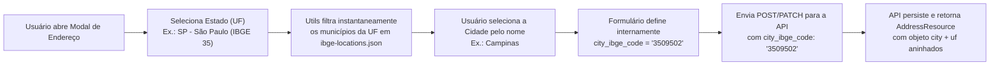

# Guia Detalhado de Funcionalidades, Módulos e Fluxos de Trabalho

Este documento detalha o funcionamento operacional e técnico de **todos os módulos** do frontend do **Apollo System**, incluindo rotas, permissões exigidas (RBAC), contratos de endpoints consumidos, validações de formulário, máscaras e regras de negócio específicas.

---

## Sumário

1. [Visão Geral dos Módulos e Rotas](#1-visão-geral-dos-módulos-e-rotas)
2. [Autenticação e Onboarding Multi-Tenant (`auth`)](#2-autenticação-e-onboarding-multi-tenant-auth)
3. [Dashboard Executivo (`/`)](#3-dashboard-executivo-)
4. [Gestão de Usuários e Permissões (`users`)](#4-gestão-de-usuários-e-permissões-users)
5. [Catálogo: Marcas (`brands`) e Categorias (`categories`)](#5-catálogo-marcas-brands-e-categorias-categories)
6. [Catálogo: Produtos e Estoque (`products`)](#6-catálogo-produtos-e-estoque-products)
7. [Parceiros Comerciais: Clientes (`clients`), Vendedores (`sellers`) e Fornecedores (`suppliers`)](#7-parceiros-comerciais-clientes-clients-vendedores-sellers-e-fornecedores-suppliers)
8. [Gestão de Endereços Polimórficos e Seleção UF $\rightarrow$ Cidade IBGE (`addresses`)](#8-gestão-de-endereços-polimórficos-e-seleção-uf--cidade-ibge-addresses)
9. [Pedidos de Venda (`sales-orders`) e Pedidos de Compra (`purchase-orders`)](#9-pedidos-de-venda-sales-orders-e-pedidos-de-compra-purchase-orders)
10. [Tabela de Referência Rápida: Máscaras e Formatadores](#10-tabela-de-referência-rápida-máscaras-e-formatadores)

---

## 1. Visão Geral dos Módulos e Rotas

| Módulo | Rota Base | Permissão de Leitura | Permissão de Criação | Permissão de Edição | Permissão de Exclusão |
| :--- | :--- | :--- | :--- | :--- | :--- |
| **Dashboard** | `/` | Livre (Autenticado) | — | — | — |
| **Produtos** | `/products` | `product.view` | `product.create` | `product.update` | `product.delete` |
| **Marcas** | `/brands` | `brand.view` | `brand.create` | `brand.update` | `brand.delete` |
| **Categorias** | `/categories` | `category.view` | `category.create` | `category.update` | `category.delete` |
| **Clientes** | `/clients` | `client.view` | `client.create` | `client.update` | `client.delete` |
| **Vendedores** | `/sellers` | `seller.view` | `seller.create` | `seller.update` | `seller.delete` |
| **Fornecedores** | `/suppliers` | `supplier.view` | `supplier.create` | `supplier.update` | `supplier.delete` |
| **Pedidos de Venda** | `/sales-orders` | `sales-order.view` | `sales-order.create` | `sales-order.update` | `sales-order.delete` |
| **Pedidos de Compra** | `/purchase-orders` | `purchase-order.view` | `purchase-order.create` | `purchase-order.update` | `purchase-order.delete` |
| **Usuários** | `/users` | `user.view` | `user.create` | `user.update` | `user.delete` |
| **Relatórios** | `/reports` | `sales-order.view` / `purchase-order.view` | — | — | — |

---

## 2. Autenticação e Onboarding Multi-Tenant (`auth`)

Localização: [`features/auth/`](file:///home/jhimy-ferrari/repos/apollo/apollo-react-next/features/auth)

### 2.1. Login (`/login`)
* **Componente**: [`LoginForm`](file:///home/jhimy-ferrari/repos/apollo/apollo-react-next/features/auth/components/login-form.tsx)
* **Endpoint**: `POST /v1/login`
* **Campos e Regras**:
  * `organization_document`: CPF (11 dígitos) ou CNPJ (14 caracteres numéricos ou alfanuméricos). Aplicada máscara dinâmica via `maskDocument()` durante a digitação e enviado limpo via `cleanDocument()`.
  * `email`: E-mail válido do operador.
  * `password`: Senha de acesso.
* **Comportamento Pós-Login**:
  * Salva o Bearer token em `localStorage` e no cookie `apollo_auth_token`.
  * Caso o payload de login não traga a relação completa de permissões de um usuário operador (`!user.is_administrator`), consulta complementarmente `GET /v1/users/{id}` para hidratar a sessão antes de redirecionar para `/`.

### 2.2. Cadastro de Organização (`/register-organization`)
* **Componente**: [`RegisterOrgForm`](file:///home/jhimy-ferrari/repos/apollo/apollo-react-next/features/auth/components/register-org-form.tsx)
* **Endpoint**: `POST /v1/organizations`
* **Campos e Regras**:
  * **Dados da Organização**:
    * `person_type`: `"individual"` (Pessoa Física) ou `"company"` (Pessoa Jurídica).
    * `name`: Nome ou Razão Social (até 90 caracteres).
    * `trade_name`: Nome Fantasia (habilitado apenas quando `person_type === "company"`, até 90 caracteres).
    * `document_number`: CPF ou CNPJ formatado dinamicamente de acordo com `person_type`.
    * `email` e `phone`: Contato principal da empresa.
  * **Dados do Administrador Inicial (`user`)**:
    * `user.name`, `user.email`, `user.password` e `user.password_confirmation` (mínimo de 8 caracteres, exigindo letras maiúsculas, minúsculas, números e símbolos).

---

## 3. Dashboard Executivo (`/`)

Localização: [`app/(dashboard)/page.tsx`](file:///home/jhimy-ferrari/repos/apollo/apollo-react-next/app/(dashboard)/page.tsx)

* **Objetivo**: Apresentar um panorama operacional imediato da organização, respeitando as permissões individuais do usuário logado.
* **Funcionamento**:
  * Consulta de forma condicional (apenas se o usuário tiver a respectiva permissão `*.view`) os contadores paginados (`meta.total`) e os registros mais recentes de **Produtos**, **Clientes**, **Pedidos de Venda** e **Pedidos de Compra**.
  * Exibe atalhos rápidos para emissão de novo Pedido de Venda, novo Pedido de Compra, cadastro de Produto e cadastro de Cliente (protegidos por `<Can>`).

---

## 4. Gestão de Usuários e Permissões (`users`)

Localização: [`features/users/`](file:///home/jhimy-ferrari/repos/apollo/apollo-react-next/features/users)

* **Rotas**:
  * `/users`: Listagem paginada com busca por nome/e-mail e badges indicando **Administrador** ou quantidade de permissões atribuídas.
  * `/users/new`: Criação de novo operador e atribuição visual de permissões.
  * `/users/[id]`: Edição de dados cadastrais, redefinição opcional de senha e atualização da matriz de permissões.
* **Endpoints**:
  * `GET /v1/users`, `GET /v1/users/{id}`, `POST /v1/users`, `PATCH /v1/users/{id}`, `DELETE /v1/users/{id}`.
* **Matriz Interativa de Permissões ([`UserForm`](file:///home/jhimy-ferrari/repos/apollo/apollo-react-next/features/users/components/user-form.tsx))**:
  * Organiza as **36 permissões** em 9 cards de domínio (`user`, `product`, `brand`, `category`, `client`, `seller`, `supplier`, `sales-order`, `purchase-order`).
  * Oferece botões de ação rápida:
    * **Selecionar Todas** (36 permissões)
    * **Apenas Leitura** (as 9 permissões `*.view`)
    * **Limpar Todas**
    * **Alternar Domínio Individual** (marca/desmarca as 4 permissões de um card específico).
* **Regras de Edição (`PATCH`)**:
  * Utiliza `calculateDiff` para enviar apenas os campos modificados. Se os campos `password` e `password_confirmation` forem deixados em branco na edição, são omitidos do payload para manter a senha atual inalterada.

---

## 5. Catálogo: Marcas (`brands`) e Categorias (`categories`)

Localizações: [`features/brands/`](file:///home/jhimy-ferrari/repos/apollo/apollo-react-next/features/brands) e [`features/categories/`](file:///home/jhimy-ferrari/repos/apollo/apollo-react-next/features/categories)

* **Rotas**:
  * Marcas: `/brands`, `/brands/new`, `/brands/[id]`
  * Categorias: `/categories`, `/categories/new`, `/categories/[id]`
* **Endpoints**:
  * `GET /v1/brands`, `GET /v1/brands/{id}`, `POST /v1/brands`, `PATCH /v1/brands/{id}`, `DELETE /v1/brands/{id}`
  * `GET /v1/categories`, `GET /v1/categories/{id}`, `POST /v1/categories`, `PATCH /v1/categories/{id}`, `DELETE /v1/categories/{id}`
* **Campos**:
  * `name` (obrigatório, máx. 45 caracteres).
  * `description` (opcional, máx. 225 caracteres).
* **Funcionalidades**:
  * Criação e edição rápida tanto por página dedicada quanto por modal, com cálculo de diff no `PATCH` e exclusão protegida por diálogo de confirmação (`ConfirmDialog`).

---

## 6. Catálogo: Produtos e Estoque (`products`)

Localização: [`features/products/`](file:///home/jhimy-ferrari/repos/apollo/apollo-react-next/features/products)

* **Rotas**:
  * `/products`: Listagem paginada com filtros combinados (busca textual, código interno, NCM, marca, faixa de preço de venda, estoque zerado).
  * `/products/new`: Formulário completo de cadastro de produto.
  * `/products/[id]`: Página unificada de detalhes e edição cadastral do produto (preços, margem, estoque atual, códigos fiscais, marca e categorias associadas).
* **Unidades de Medida Suportadas (`ProductUnit`)**:
  * `un` (Unidade), `kg` (Quilograma), `g` (Grama), `t` (Tonelada), `l` (Litro), `ml` (Mililitro), `m` (Metro), `m2` (Metro Quadrado), `m3` (Metro Cúbico), `cx` (Caixa), `pc` (Peça), `pct` (Pacote), `fd` (Fardo), `par` (Par).
* **Regras de Negócio Críticas**:
  1. **Limite de Tamanho do Nome**: Máximo de **45 caracteres** (alinhado com `varchar(45)` do banco de dados).
  2. **Códigos Fiscais e de Barras**:
     * `ncm`: Exatamente 8 dígitos numéricos (formatado visualmente como `0000.00.00` via `maskNCM` e enviado apenas dígitos para a API).
     * `ean`: Código de barras EAN de 8, 12, 13 ou 14 dígitos numéricos.
  3. **Preços e Quantidades com Vírgula**:
     * `cost_price` e `sale_price`: Máscara `maskPrice` (até 4 casas decimais com vírgula).
     * `stock_quantity`: Máscara `maskStock` (até 3 casas decimais com vírgula), disponível **exclusivamente na criação (`POST /v1/products`)**. Na edição (`PATCH /v1/products/{id}`), o estoque não é editável diretamente.
  4. **Associação Multi-Categoria**:
     * Permite vincular múltiplas categorias ao produto, enviadas no formato `categories: [{ id: string }]`.

---

## 7. Parceiros Comerciais: Clientes (`clients`), Vendedores (`sellers`) e Fornecedores (`suppliers`)

Localizações: [`features/clients/`](file:///home/jhimy-ferrari/repos/apollo/apollo-react-next/features/clients), [`features/sellers/`](file:///home/jhimy-ferrari/repos/apollo/apollo-react-next/features/sellers) e [`features/suppliers/`](file:///home/jhimy-ferrari/repos/apollo/apollo-react-next/features/suppliers)

* **Rotas (Padrão idêntico para os 3 módulos)**:
  * Listagem: `/clients`, `/sellers`, `/suppliers`
  * Criação: `/clients/new`, `/sellers/new`, `/suppliers/new`
  * Detalhes, Edição Cadastral e Gestão de Endereços (em abas): `/clients/[id]`, `/sellers/[id]`, `/suppliers/[id]`
* **Alternância Dinâmica Pessoa Física vs. Pessoa Jurídica (`person_type`)**:
  * Quando `person_type === "individual"` (PF):
    * O campo `trade_name` (Nome Fantasia) é desabilitado e limpo automaticamente.
    * O campo `document_number` aplica máscara de CPF (`000.000.000-00`).
    * O campo `state_registration` (Inscrição Estadual) é opcional.
  * Quando `person_type === "company"` (PJ):
    * O campo `trade_name` (Nome Fantasia) fica disponível.
    * O campo `document_number` aplica máscara de CNPJ alfanumérico (`XX.XXX.XXX/XXXX-XX`).
* **Particularidade de Vendedores (`sellers`)**:
  * Possui o campo adicional `commission_percentage` (Percentual de Comissão de `0` a `100%`, suportando até 2 casas decimais).
* **Abas na Página de Detalhes (`/[id]`)**:
  * **Aba "Dados Cadastrais"**: Exibe documento formatado, tipo de pessoa, inscrição estadual, contatos, comissão (para vendedores) e datas de auditoria.
  * **Aba "Endereços"**: Renderiza o componente polimórfico [`AddressList`](file:///home/jhimy-ferrari/repos/apollo/apollo-react-next/features/addresses/components/address-list.tsx) vinculado ao parceiro.

---

## 8. Gestão de Endereços Polimórficos e Seleção UF $\rightarrow$ Cidade IBGE (`addresses`)

Localização: [`features/addresses/`](file:///home/jhimy-ferrari/repos/apollo/apollo-react-next/features/addresses)

O módulo de endereços atende polimorficamente a **Clientes**, **Vendedores** e **Fornecedores** através dos endpoints:
* `POST /v1/{clients|sellers|suppliers}/{ownerId}/addresses`
* `PATCH /v1/{clients|sellers|suppliers}/{ownerId}/addresses/{addressId}`
* `DELETE /v1/{clients|sellers|suppliers}/{ownerId}/addresses/{addressId}`

### 8.1. Experiência do Usuário: Seleção de UF e Cidade (Código IBGE Transparente)

Para eliminar a necessidade de o operador conhecer ou pesquisar códigos numéricos do IBGE:



1. **Fonte de Dados (`features/addresses/data/ibge-locations.json`)**:
   * Contém todas as **27 UFs** (`ibge_code`, `acronym`, `name`) e os **5.570 municípios brasileiros** mapeados por UF (`citiesByUf`).
2. **Utilitários de Busca (`features/addresses/utils/locations.ts`)**:
   * `UFS`: Lista ordenada das 27 UFs.
   * `getCitiesByUf(ufIbgeCode)`: Retorna os municípios da UF selecionada com cache em `Map`.
   * `getCityByIbgeCode(cityIbgeCode)`: Resolve qualquer município em $O(1)$ a partir dos 2 primeiros dígitos do código IBGE de 7 dígitos (que identificam a UF).
   * `resolveAddressUfIbgeCode(address)`: Na edição de um endereço existente, extrai a UF a partir de `address.city.uf.ibge_code`, `address.city.uf_ibge_code` ou do prefixo de 2 dígitos de `address.city_ibge_code`, pré-selecionando automaticamente o Estado e a Cidade corretos no modal.
3. **Demais Campos do Endereço**:
   * `postal_code`: CEP com máscara `00000-000` (enviado como 8 dígitos numéricos).
   * `street`: Logradouro (obrigatório, máx. 90 caracteres).
   * `number`: Número (obrigatório, ex.: `"123"` ou `"S/N"`).
   * `neighborhood`: Bairro (obrigatório, máx. 60 caracteres).
   * `complement`: Complemento (opcional, máx. 90 caracteres).
   * `description`: Rótulo identificador do endereço (opcional, ex.: `"Matriz"`, `"Entrega"`, `"Cobrança"`).

---

## 9. Pedidos de Venda (`sales-orders`) e Pedidos de Compra (`purchase-orders`)

Localizações: [`features/sales-orders/`](file:///home/jhimy-ferrari/repos/apollo/apollo-react-next/features/sales-orders) e [`features/purchase-orders/`](file:///home/jhimy-ferrari/repos/apollo/apollo-react-next/features/purchase-orders)

Ambos os módulos compartilham a mesma arquitetura transacional, diferenciando-se pelos atores envolvidos e pelo sentido da movimentação de estoque:
* **Pedido de Venda (`sales-orders`)**: Vincula um **Cliente (`client_id`)** obrigatório e um **Vendedor (`seller_id`)** opcional. Sua confirmação **baixa (reduz)** o estoque dos produtos. Usa como base o `sale_price` do produto.
* **Pedido de Compra (`purchase-orders`)**: Vincula um **Fornecedor (`supplier_id`)** obrigatório. Sua confirmação **alimenta (aumenta)** o estoque dos produtos. Usa como base o `cost_price` do produto.

### 9.1. Estados do Pedido e Status de Pagamento

| Tipo | Valor na API | Rótulo na UI | Cor do Badge |
| :--- | :--- | :--- | :--- |
| **Status do Pedido** | `"draf"` *(grafia literal da API)* | Rascunho | Neutro / Secundário |
| **Status do Pedido** | `"confirmed"` | Confirmado | Verde / Sucesso |
| **Status do Pedido** | `"cancelled"` | Cancelado | Vermelho / Destrutivo |
| **Status de Pagamento** | `"pending"` | Pendente | Amarelo / Alerta |
| **Status de Pagamento** | `"paid"` | Pago | Verde / Sucesso |

### 9.2. Criação de Pedido (`POST /v1/{sales|purchase}-orders`)
* Todo pedido nasce no status `"draf"` (Rascunho).
* O operador seleciona o parceiro comercial, status de pagamento (`pending` ou `paid`), observações (`notes`) e adiciona os itens (`product_id` e `quantity`).
* A interface calcula em tempo real o subtotal estimado de cada linha e o total geral do pedido à medida que produtos e quantidades são alterados.

### 9.3. Edição de Pedido em Rascunho (`PATCH /v1/{sales|purchase}-orders/{id}`)
* Apenas pedidos com `status === "draf"` podem ser editados.
* O formulário calcula automaticamente:
  1. As alterações de cabeçalho (`client_id`/`supplier_id`, `seller_id`, `payment_status`, `notes`).
  2. O **diff estruturado de itens (`items`)** comparando a lista original do pedido com a lista presente no formulário:
     ```json
     {
       "payment_status": "paid",
       "items": {
         "to_add": [
           { "product_id": "uuid-novo-produto", "quantity": 5 }
         ],
         "to_update": [
           { "number": 1, "product_id": "uuid-produto-1", "quantity": 10 }
         ],
         "to_remove": [
           { "number": 2 }
         ]
       }
     }
     ```

### 9.4. Ações Transacionais na Página de Detalhes (`/[id]`)

1. **Confirmar Pedido (`PATCH /v1/{orders}/{id}/confirm`)**:
   * Disponível apenas quando `status === "draf"`.
   * Efetiva a movimentação de estoque no backend e altera o status para `"confirmed"`.
   * Se não houver saldo de estoque suficiente (no caso de Pedido de Venda), o backend retorna `422` e o frontend exibe a mensagem exata no toast de erro.
2. **Cancelar Pedido (`PATCH /v1/{orders}/{id}/cancel`)**:
   * Disponível quando `status === "draf"` ou `status === "confirmed"`.
   * Abre um modal solicitando opcionalmente o **Motivo do Cancelamento (`reason`)**.
   * Caso o pedido já estivesse confirmado, o backend estorna automaticamente as movimentações de estoque e grava `cancellation_reason` e `cancelled_at`.
3. **Reabrir Pedido (`PATCH /v1/{orders}/{id}/reopen`)**:
   * Disponível quando `status === "confirmed"` ou `status === "cancelled"`.
   * Cria um **novo pedido em rascunho (`draf`)** copiando os dados e itens do pedido original, cancelando o original caso estivesse confirmado.
   * **Rastreabilidade Bidirecional**:
     * No pedido antigo, exibe um card/badge informando que ele foi **Substituído pelo Pedido #Y** (com link clicável).
     * No pedido novo, exibe um card/badge informando que ele **Substitui o Pedido #X** (com link clicável).
   * **Alerta de Preços Desatualizados (`outdated_prices`)**:
     * Se algum item do pedido reaberto teve seu preço de catálogo alterado desde a negociação original, a resposta do endpoint `/reopen` retorna o array `outdated_prices` (contendo `product_id`, `name`, `negotiated_price` e `current_price`), que é destacado no topo da tela de detalhes para ciência do operador antes de reconfirmar o pedido.

---

## 10. Relatórios (`reports`)

Localização: [`features/reports/`](file:///home/jhimy-ferrari/repos/apollo/apollo-react-next/features/reports) · Rotas em `app/(dashboard)/reports/`.

| Relatório | Rota | Endpoint | Permissão |
| :--- | :--- | :--- | :--- |
| Índice de relatórios | `/reports` | — | Qualquer permissão de relatório |
| Vendas (resumo) | `/reports/sales/summary` | `GET /v1/reports/sales/summary` | `sales-order.view` |
| Vendas por produto | `/reports/sales/by-product` | `GET /v1/reports/sales/by-product` | `sales-order.view` |
| Vendas por vendedor | `/reports/sales/by-seller` | `GET /v1/reports/sales/by-seller` | `sales-order.view` |
| Compras (resumo) | `/reports/purchases/summary` | `GET /v1/reports/purchases/summary` | `purchase-order.view` |

* **Filtros** ([`ReportFilterBar`](file:///home/jhimy-ferrari/repos/apollo/apollo-react-next/features/reports/components/report-filter-bar.tsx)): período (`start_date`/`end_date`, data final ≥ inicial), `date_field` (`confirmed_at`/`created_at`), `status`, `payment_status`, cliente, vendedor, fornecedor, produto, categoria e marca, além de ordenação (`order_by`/`order_direction`) nos relatórios agrupados. Os filtros são aplicados somente ao clicar em **Aplicar filtros**.
* **Seletores de entidade**: carregam até 100 registros (`per_page=100`) e só aparecem se o usuário tiver a permissão `*.view` da entidade, evitando `403`.
* **Status padrão**: sem `status`, a API considera apenas pedidos **confirmados**. A distribuição por status/pagamento nos resumos ignora o filtro de status.
* **Valores monetários**: os campos `*_formatted` calculados pelo backend são exibidos diretamente, sem conversão para `float` no cliente.
* **Paginação**: o `meta` enxuto dos relatórios é adaptado para o [`DataTablePagination`](file:///home/jhimy-ferrari/repos/apollo/apollo-react-next/components/common/data-table-pagination.tsx) padrão (15 itens por página).

---

## 11. Tabela de Referência Rápida: Máscaras e Formatadores

| Finalidade | Função | Arquivo | Exemplo de Entrada | Resultado Formatado |
| :--- | :--- | :--- | :--- | :--- |
| **Moeda Brasileira (BRL)** | `formatBRL(value)` | [`lib/formatters.ts`](file:///home/jhimy-ferrari/repos/apollo/apollo-react-next/lib/formatters.ts) | `"1250.5"` / `"9.8765"` | `"R$ 1.250,50"` / `"R$ 9,8765"` |
| **Data e Hora (pt-BR)** | `formatDateTime(iso)` | [`lib/formatters.ts`](file:///home/jhimy-ferrari/repos/apollo/apollo-react-next/lib/formatters.ts) | `"2026-10-09T15:00:00Z"` | `"09/10/2026, 12:00"` |
| **Data Curta (pt-BR)** | `formatDate(iso)` | [`lib/formatters.ts`](file:///home/jhimy-ferrari/repos/apollo/apollo-react-next/lib/formatters.ts) | `"2026-10-09T15:00:00Z"` | `"09/10/2026"` |
| **Quantidade + Unidade** | `formatQuantity(qty, unit)` | [`lib/formatters.ts`](file:///home/jhimy-ferrari/repos/apollo/apollo-react-next/lib/formatters.ts) | `(12.5, "kg")` | `"12,5 kg"` |
| **CPF (11 dígitos)** | `maskCPF(val)` | [`lib/masks.ts`](file:///home/jhimy-ferrari/repos/apollo/apollo-react-next/lib/masks.ts) | `"12345678909"` | `"123.456.789-09"` |
| **CNPJ Numérico/Alfanumérico** | `maskCNPJ(val)` | [`lib/masks.ts`](file:///home/jhimy-ferrari/repos/apollo/apollo-react-next/lib/masks.ts) | `"11222333000181"` | `"11.222.333/0001-81"` |
| **Documento Dinâmico (CPF/CNPJ)** | `maskDocument(val)` | [`lib/masks.ts`](file:///home/jhimy-ferrari/repos/apollo/apollo-react-next/lib/masks.ts) | `"11222333000181"` | `"11.222.333/0001-81"` |
| **CEP (8 dígitos)** | `maskCEP(val)` | [`lib/masks.ts`](file:///home/jhimy-ferrari/repos/apollo/apollo-react-next/lib/masks.ts) | `"01310100"` | `"01310-100"` |
| **Telefone Fixo / Celular** | `maskPhone(val)` | [`lib/masks.ts`](file:///home/jhimy-ferrari/repos/apollo/apollo-react-next/lib/masks.ts) | `"11987654321"` | `"(11) 98765-4321"` |
| **Código NCM (8 dígitos)** | `maskNCM(val)` | [`lib/masks.ts`](file:///home/jhimy-ferrari/repos/apollo/apollo-react-next/lib/masks.ts) | `"84713012"` | `"8471.30.12"` |
| **Preço Decimal com Vírgula** | `maskPrice(val)` | [`lib/masks.ts`](file:///home/jhimy-ferrari/repos/apollo/apollo-react-next/lib/masks.ts) | `"149.9055"` | `"149,9055"` |
| **Estoque Decimal com Vírgula** | `maskStock(val)` | [`lib/masks.ts`](file:///home/jhimy-ferrari/repos/apollo/apollo-react-next/lib/masks.ts) | `"2.500"` | `"2,500"` |
